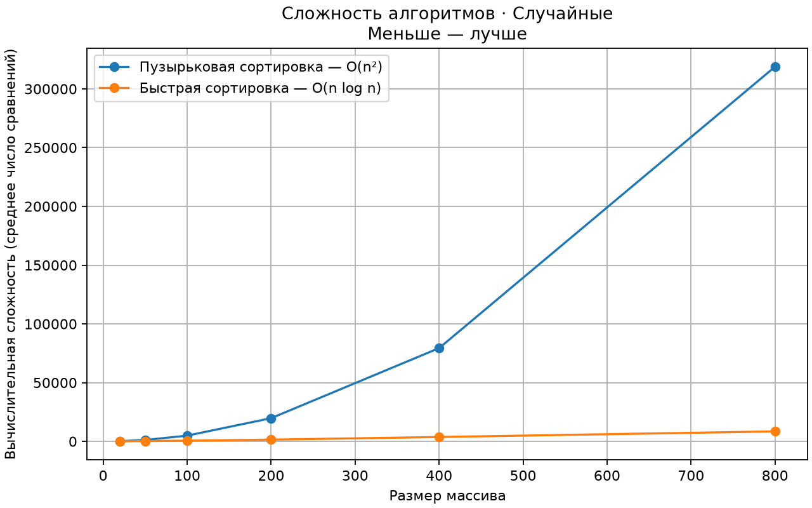

# Сравнение сортировок

Программа на Python и matplotlib сравнивает пузырьковую и быструю сортировки.
График показывает среднее число сравнений элементов: **меньше — лучше**.



## Запуск

Установка зависимостей один раз:

```bash
python -m venv venv
source venv/bin/activate
pip install -r requirements.txt
```

```bash
python comparison.py
python animation.py
```

После активации `venv` команда `python` использует зависимости проекта.
Интерактивное окно Matplotlib работает через PyQt6 из `requirements.txt`.

`comparison.py` строит график сложности, а `animation.py` показывает процесс
сортировки столбиков.

## Настройки

В начале `comparison.py`:

- `ALGORITHMS` — какие алгоритмы сравнивать;
- `SIZES` — размеры массивов;
- `SAMPLES` — сколько массивов каждого размера брать для усреднения;
- `SEED` — одинаковое значение даёт одинаковые случайные массивы;
- `ARRAY_TYPE` — тип массивов; варианты перечислены в коде.

В начале `animation.py` можно выбрать `ALGORITHM`, `SIZE`, `SEED` и `INTERVAL`.

Каждый алгоритм находится в своём файле в `algorithms/`. Чтобы добавить новый,
создайте файл, добавьте импорты и строку в `ALGORITHMS`. Функция должна возвращать
`(отсортированный_массив, число_сравнений)`, сохраняя исходный массив.

O-нотация в легенде указывает среднюю сложность; худший случай quick sort — O(n²).

### Как работают сортировки

- Пузырьковая сортировка сравнивает соседние элементы и меняет их местами.
  После каждого прохода самый большой элемент оказывается в конце массива.
- Быстрая сортировка выбирает последний элемент как опорный, переносит меньшие
  элементы влево, ставит опорный элемент на правильное место и рекурсивно
  сортирует части слева и справа от него.

## Как объяснить программу

`comparison.py` работает в четыре шага:

1. `generate_array` создаёт исходные массивы.
2. `measure_comparisons` запускает обе сортировки на одинаковых данных.
3. Алгоритмы возвращают отсортированный массив и число сравнений.
4. `show_complexity` строит график средних значений.

Обе программы импортируют одни и те же функции из папки `algorithms`.
`comparison.py` просто получает результат и число сравнений. `animation.py`
передаёт алгоритму функцию `on_step`, которая сохраняет состояние массива после
каждого шага. Поэтому код сортировок не дублируется.

`FuncAnimation` по очереди передаёт сохранённые состояния в `draw`, а `draw`
меняет высоту и цвет столбиков. Синие элементы ожидают обработки, красные сейчас
сравниваются, зелёные означают завершённую сортировку.
